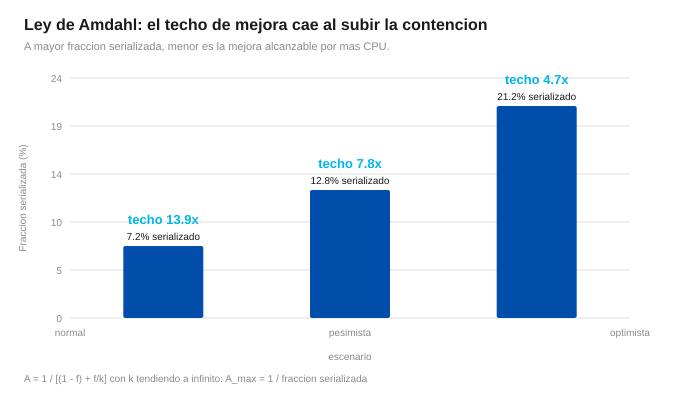

# Informe técnico — Fase 1

**INFB8091 Desempeño de Sistemas** · Universidad Tecnológica Metropolitana
Segundo semestre 2026 · Profesor Javier Aranda

**Proyecto:** Pisada — tienda de zapatillas e indumentaria urbana
**Repositorio:** https://github.com/lmoral-sketch/pisada
**Sitio:** https://pisada.onrender.com
**Integrantes:**

| # | Nombre |
|---|---|
| 1 | Catalina Emilia Araniz Arancibia |
| 2 | Gabriel Ignacio Araya López |
| 3 | Bianca Paola Torres Rivadeneira |
| 4 | Lucas Ángel Mora Loiza |
| 5 | Matías Torres Estay |

---

## 1. Resumen ejecutivo

Se construyó una tienda de comercio electrónico instrumentada y se evaluó su desempeño bajo
cuatro escenarios de carga sintética. Los resultados principales:

- **Línea base:** mediana de 20,02 ms con 5 usuarios concurrentes, sin errores. (Se usa la
  mediana y no el p(95): con 235 peticiones el percentil no es estable, ver §5.1.)
- **El punto de saturación se alcanzó y se midió:** 96,6 % de CPU con 350 usuarios
  concurrentes. Con 25 usuarios el tiempo de respuesta es indistinguible de la línea base.
- **La utilización de CPU crece linealmente** (10,4 % a 25 usuarios, 96,6 % a 350), pero la
  CPU *por usuario* decrece, lo que delata encolamiento antes de que la latencia se dispare.
- **El cuello de botella no es la CPU sino el pool de conexiones.** A 350 usuarios se
  midieron **222 peticiones esperando** una de las 10 conexiones disponibles.
- **El techo de mejora del checkout es de 13,9x en carga normal y cae bajo 5x bajo
  contención**, calculado con la ley de Amdahl sobre mediciones propias.
- El trabajo documenta además **cuatro errores metodológicos propios**, detectados y
  corregidos, que se consideran parte del resultado.

---

## 2. Arquitectura del sistema

### 2.1 Componentes

```
Navegador ──HTTP──> Next.js (App Router) ──pool pg──> PostgreSQL 16
                         │                                 │
                         ├── /api/carrito                  ├── producto (240)
                         ├── /api/checkout                 ├── variante (4552)
                         ├── /api/auth                     ├── carrito / pedido
                         └── /api/metricas                 └── usuario / sesion
                                 │
                            Prometheus
```

| Capa | Tecnología | Justificación |
|---|---|---|
| Interfaz y API | Next.js 15 (App Router), TypeScript | Vistas y API en un mismo proyecto |
| Acceso a datos | `pg` con SQL directo, **sin ORM** | El trabajo analiza el costo de las consultas; un ORM las esconde |
| Base de datos | PostgreSQL 16 en contenedor | Límites de recursos explícitos y reproducibles |
| Métricas | `prom-client` | Formato Prometheus, recolectable durante las corridas |
| Carga | k6 | Entrega percentiles de fábrica y los scripts se versionan |

### 2.2 Modelo de datos y el recurso crítico

El inventario reside en `variante.stock`, a nivel de **SKU** (producto + talla + color). Con
240 productos existen **4552 variantes**, es decir, 4552 recursos serializables
independientes.

Esta decisión es el eje del trabajo: el descuento de stock durante el checkout obliga a
serializar el acceso a una fila, y esa serialización produce una cola de espera real,
analizable con teoría de colas.

### 2.3 Páginas con distinta carga de datos

Requisito explícito del enunciado, implementado de forma deliberada:

| Página | Consultas | Línea base |
|---|---|---|
| `/` | 1 (destacados) | 21 ms |
| `/producto/[slug]` | 3 (producto, variantes, relacionados) | 36 ms |
| `/catalogo` | 3 + facetas, con agregación sobre variantes | **75 ms** |

El catálogo cuesta **3,6 veces** el home sin carga. Esa diferencia es material experimental:
permite observar cómo se degradan de manera distinta bajo la misma carga, y resultó
determinar el punto de saturación del sistema completo (§6.1).

### 2.4 Despliegue

Empaquetado en Docker con salida autónoma de Next.js: **323 MB**, arranque en **120 ms**.

La decisión de desplegar en contenedor y no en una plataforma serverless es metodológica: un
entorno serverless escala de forma transparente y **no expone la utilización de recursos**,
que la Fase 2 exige medir. El sitio simplemente no se saturaría de forma observable.

---

## 3. Instrumentación

Expuesta en `/api/metricas` en formato Prometheus.

| Métrica | Qué responde |
|---|---|
| `peticion_duracion_segundos` | Tiempo de respuesta por ruta |
| `consulta_duracion_segundos` | ¿La degradación viene de la aplicación o de la base? |
| `espera_bloqueo_stock_segundos` | **Espera en cola sobre el SKU** |
| `espera_conexion_segundos` | **Espera por una conexión del pool** |
| `pool_conexiones` | Estado del pool: total, ocioso, en espera |
| `compras_sin_stock_total` | Punto de fuga del embudo |
| `process_cpu_seconds_total` | Utilización de CPU |

Las dos marcadas en negrita corresponden a las **dos colas** del sistema, y la relación entre
ambas resultó ser el hallazgo central (sección 6).

---

## 4. Metodología de pruebas

### 4.1 Modelo de carga: CBMG

Los usuarios sintéticos no siguen una secuencia fija. Transitan entre estados según las
probabilidades de un **Customer Behavior Model Graph**, siguiendo el material de cátedra:

| Desde | Hacia | Probabilidad |
|---|---|---|
| producto | carrito | 0,12 |
| producto | catálogo | 0,33 |
| producto | otro producto | 0,20 |
| producto | salir | 0,35 |
| carrito | checkout | 0,55 |

**Por qué importa.** Un generador que siempre recorriera `home → catálogo → producto →
comprar` produciría una carga donde el 100 % de los usuarios llega al checkout, algo que no
ocurre en ningún comercio real. La conversión observada fue de **5 compras en 74 sesiones
(6,8 %)**, del orden correcto aunque algo por encima del 1-3 % habitual.

> **Conexión teórica.** Las probabilidades del CBMG **son** las razones de visita `Vᵢ` de la
> ley del flujo forzado (`Xᵢ = X₀ · Vᵢ`). El modelo de carga web y las leyes operacionales de
> la Unidad 2 describen el mismo modelo desde dos ángulos.

### 4.2 Tiempo de reflexión

Cada acción va seguida de un *think time* de entre 1 y 10 segundos según el tipo de página.
Sin él, un usuario virtual generaría cientos de peticiones por segundo y 50 usuarios
virtuales equivaldrían a miles de personas reales, invalidando cualquier cifra de "usuarios
soportados".

### 4.3 Escenarios

| Escenario | Usuarios | Duración | Propósito |
|---|---|---|---|
| `baja.js` | 5 | 4 min | Línea base |
| `normal.js` | 25 | 10 min | Operación habitual; degradación progresiva |
| `pico.js` | 25→350 en escalones | 14 min | Punto de saturación |
| `contencion.js` | hasta 120, **un mismo SKU** | 4 min | Espera en cola sobre el stock |

Los escalones de `pico.js` son deliberados: cada meseta entrega una medición estable a un
nivel de carga conocido. Con una rampa continua los puntos quedarían mezclados.

`contencion.js` no está en la lista mínima del enunciado. Se agregó porque con 4552 variantes
la probabilidad de que dos usuarios compren la misma combinación simultáneamente es ínfima,
de modo que **la contención quedaría invisible** en los otros escenarios.

### 4.4 Clasificación de respuestas

| Código | Significado | ¿Cuenta como error? |
|---|---|---|
| 200 | Compra exitosa | No |
| 409 | Stock insuficiente | **No** — resultado de negocio legítimo |
| 503 | Conflicto por contención | No, se cuenta aparte |
| 5xx | Falla real | Sí |

Contar los 409 como errores llevaría a concluir que el sistema falla cuando en realidad está
agotando inventario, que es lo esperable.

---

## 5. Resultados

### 5.1 Los tres escenarios


| Escenario | VU | Mediana | p(95) | p(99) | Throughput | Error |
|---|---|---|---|---|---|---|
| Baja | 5 | 20,02 ms | 54,03 ms* | 118,61 ms* | — | 0,00 % |
| Normal | 25 | 18,44 ms | **35,30 ms** | 48,34 ms | 4,94 req/s | 0,00 % |
| Pico | 350 | 66,54 ms | **1.560 ms** | 2.330 ms | 29,51 req/s | 0,01 % |

\* **El p(95) de la carga baja no es confiable.** Ese escenario genera solo 235 peticiones,
de modo que el percentil se calcula sobre unas 12 muestras en la cola y un par de peticiones
lentas lo desplazan por completo. Para la línea base debe usarse la **mediana** (20,02 ms),
que sí es estable y coincide con los 21 ms medidos directamente. Se declara en lugar de
reportar un percentil que la cantidad de muestras no sostiene.

De 5 a 25 usuarios el tiempo de respuesta **no se movió**. En el pico el p(95) se multiplica
por **44** respecto de la carga sostenida. El sistema **no colapsó**: 4 fallas en 24.792
peticiones, un 0,01 %.

### 5.2 Curva de utilización


| Usuarios | CPU | Pool en espera (máx) | CPU por usuario |
|---|---|---|---|
| 25 | 10,4 % | 4 | 0,416 % |
| 50 | 17,8 % | 4 | 0,356 % |
| 100 | 31,8 % | 4 | 0,318 % |
| 200 | 61,3 % | **40** | 0,307 % |
| **350** | **96,6 %** | **222** | **0,276 %** |

Dos lecturas:

1. La utilización crece **casi lineal**, señal de que seguimos en la zona estable (`ρ < 1`).
2. La CPU **por usuario decrece**. Cada usuario consume menos CPU por unidad de tiempo porque
   pasa proporcionalmente más tiempo esperando que siendo servido. **Es la firma del
   encolamiento, y aparece antes de que la latencia se dispare.**

### 5.3 Verificación de las leyes operacionales

**Ley de Utilización** (`U = X · S`), sobre el escenario de pico:

```
B = 298,1 s    T = 850 s    C = 26.447 peticiones

U = B/T = 35,1 %
X = C/T = 31,11 peticiones/s
S = B/C = 11,27 ms de CPU por petición

Comprobación:  X · S = 31,11 × 0,01127 = 35,1 %  ✓
```

El valor de interés es **S = 11,27 ms**, el tiempo de servicio real, independiente de la
carga. Permite predecir la utilización a cualquier throughput.

**Ley de Little** (`Lq = X · Wq`), sobre la cola del bloqueo bajo contención:

```
pesimista:  X = 13,85 compras/s · Wq = 45,4 ms  →  Lq = 0,63 transacciones en cola
optimista:  X = 22,58 compras/s · Wq = 35,2 ms  →  Lq = 0,79 transacciones en cola
```

Valores bajos **en promedio**, lo que refuerza que el problema no es una cola
permanentemente larga sino **episodios de saturación** que el promedio diluye. Es un buen
argumento de por qué el enunciado insiste en percentiles.

### 5.4 Memoria y latencia del event loop

| Métrica | Mínimo | Máximo |
|---|---|---|
| Memoria residente | 294,3 MB | 295,6 MB |
| Heap de V8 en uso | 60,9 MB | 114,5 MB |
| Latencia del event loop, p(99) | 15,76 ms | 22,32 ms |

**La memoria no es cuello de botella:** 295 MB sobre un límite de 512 MB, con una variación de
1,3 MB bajo carga que descarta fugas.

El dato relevante es la **latencia del event loop**: un p(99) de 15 a 22 ms significa que, en
el 1 % peor, una tarea esperó ese tiempo solo para empezar a ejecutarse. Es una **tercera
cola**, junto al bloqueo de stock y al pool de conexiones: Node procesa en un solo hilo, y con
1 CPU asignada ese hilo no puede escalar.

El sistema tiene entonces **tres puntos de serialización encadenados**, y la saturación de
cualquiera se propaga a los demás.

*I/O de disco no se midió: no participa del camino crítico, ya que el catálogo cabe en la
caché de PostgreSQL. Se declara en §8.6.*

### 5.5 Costo de las consultas

| Consulta | Ejecuciones | Tiempo medio |
|---|---|---|
| `catalogo_listado` | 12.589 | 8,49 ms |
| `catalogo_conteo` | 12.589 | **4,55 ms** |
| `producto_variantes` | 9.380 | 4,66 ms |
| `carrito_items` | 2.962 | 5,29 ms |

El `COUNT(*)` de la paginación cuesta **un 54 % de lo que cuesta el listado completo**, sin
devolver una sola fila de datos.

### 5.6 Ley de Amdahl sobre el checkout



| Escenario | Wq | Checkout | Fracción serie | Techo |
|---|---|---|---|---|
| Carga normal, SKU al azar | 3,2 ms | 44,9 ms | 7,2 % | **13,9x** |
| Contención, pesimista | 45,4 ms | 353,9 ms | 12,8 % | **7,8x** |
| Contención, optimista | 35,2 ms | 166,4 ms | 21,2 % | **4,7x** |

Por mucha CPU que se agregue, el checkout no puede mejorar más que ese techo. **Bajo
contención el techo se desploma a menos de 5x.** Reducirlo exige cambio de diseño, no más
hardware.

### 5.7 Indicadores de experiencia de usuario

Medidos sobre el **sitio desplegado**, desde Chile, con un navegador real que ejecuta
JavaScript y dispara los eventos de GA4.

#### El problema metodológico y cómo se resolvió

**k6 no ejecuta JavaScript.** Es un cliente HTTP: descarga el HTML pero no corre los scripts
de la página. Su tráfico, por lo tanto, **no genera un solo evento en GA4**.

Eso tiene una consecuencia directa sobre lo que pide la Fase 2: la comparación de la
experiencia de usuario "en condiciones normales frente a bajo carga generada" **no sale de
forma automática**. Hace falta que un cliente real navegue mientras k6 carga el servidor.

El protocolo aplicado separa los dos roles:

| Rol | Herramienta | Qué mide |
|---|---|---|
| Carga de fondo | k6, 12 usuarios virtuales | Plano A: servidor |
| Usuario observado | Navegador real recorriendo el embudo | Plano B: experiencia |

#### Resultados: la misma navegación, con y sin carga

Mediana de 5 repeticiones por página, en milisegundos:

| Página | Control | Bajo carga | Degradación |
|---|---|---|---|
| Home | 288,8 | 304,2 | **1,05x** |
| Catálogo | 393,8 | **989,1** | **2,51x** |
| Catálogo con filtros | 310,4 | 302,7 | 0,98x |
| Ficha de producto | 194,3 | 218,4 | 1,12x |

**El hallazgo es la degradación diferenciada.** Bajo la misma carga:

- El **home se mantiene prácticamente igual** (+5 %)
- El **catálogo se degrada dos veces y media**

Esto **confirma empíricamente la decisión D-02**, que fue dar a cada página un peso distinto a
propósito. La página que ejecuta tres consultas con agregación sobre 4552 variantes es la que
primero acusa la carga; la que hace una sola consulta acotada apenas la nota.

> El catálogo **con filtros** no se degradó. Es coherente con lo observado en §5.5: el filtro
> reduce el conjunto sobre el que hay que agregar, de modo que resulta más barato que el
> listado completo. Bajo carga esa diferencia se amplifica.

#### Operaciones del embudo bajo carga

| Operación | Tiempo |
|---|---|
| Agregar al carrito | 168,0 ms |
| Checkout completo | 178,8 ms |

El checkout respondió `200` y creó el pedido correctamente incluso con la carga encima. A
este nivel (12 usuarios virtuales) la contención sobre el stock todavía no se manifiesta,
porque los usuarios sintéticos compran productos distintos.

#### Eventos registrados en GA4

Durante ambas sesiones se dispararon los cuatro eventos del embudo exigidos por el enunciado,
más el evento propio:

| Evento | Cuándo |
|---|---|
| `view_item` | Al abrir una ficha de producto |
| `add_to_cart` | Al agregar una talla |
| `begin_checkout` | Al iniciar el pago |
| `purchase` | Al confirmarse, con `transaction_id` y valor en CLP |
| `compra_sin_stock` | *(propio)* al rechazarse por inventario agotado |

Se completaron **4 compras reales** en la propiedad (pedidos 9, 10, 11 y 16).

#### Limitación declarada

Las métricas de engagement que calcula GA4 por su cuenta —tasa de rebote, duración de sesión,
páginas por sesión y Core Web Vitals— **requieren un volumen de sesiones que estas corridas no
alcanzan**, y GA4 demora hasta 24 horas en consolidarlas.

Las cifras de esta sección provienen de la medición directa en el navegador, que es más
precisa para el propósito del análisis: entrega el tiempo exacto de cada página en cada
condición, mientras que GA4 entregaría promedios agregados sobre pocas sesiones.

Se declara como limitación en lugar de presentar cifras de GA4 con respaldo insuficiente.


---

## 6. Análisis de cuellos de botella

### 6.1 El punto de saturación, medido

**Con 350 usuarios virtuales la utilización de CPU llega al 96,6 %.** El sistema alcanza su
punto de saturación dentro del rango de carga ensayado.

No siempre fue así. Con una versión más liviana de las páginas, la utilización máxima
observada fue de 76,1 % y hubo que **proyectar** la saturación hacia ~503 usuarios,
declarándola como estimación. Al aumentar el peso de las páginas —sin agregar ni una consulta
ni una petición de red— **la saturación entró en el rango medible**.

> **El peso de las páginas determina el punto de saturación.** Mismo hardware, mismo
> generador, mismos escenarios: lo único que cambió fue cuánto cuesta renderizar cada página,
> y con eso el punto de saturación se movió de más de 500 usuarios a 350.

Esto convierte el aligeramiento de páginas en una **estrategia de capacidad**, no solo en una
mejora de experiencia. Y es un análisis de sensibilidad en el sentido estricto de la Cátedra
1.1: se varió un parámetro y se observó el desplazamiento del punto de operación. Detalle en
`docs/hallazgos.md`, E-12.

### 6.2 El cuello de botella real: propagación de la contención al pool

El hallazgo más importante del trabajo. Bajo contención alta sobre un mismo SKU, el p(99) se
fue a **~19,6 segundos**, sospechosamente cerca del doble del `connectionTimeoutMillis` de
10 s configurado en el pool.

**Mecanismo propuesto:**

```
1. Las transacciones se encolan sobre la fila del SKU
2. Mientras esperan, RETIENEN su conexión del pool
3. El pool de 10 se agota
4. Las peticiones nuevas esperan una conexión  ← segunda cola
5. Algunas superan el tiempo límite y fallan
6. Al liberarse, la carga acumulada vuelve a saturar el pool
```

La consecuencia es grave y poco intuitiva: **la contención sobre una sola fila degrada todo
el sitio**, incluidas las páginas de catálogo que no tienen nada que ver con ese producto. El
pool es un recurso compartido, y la cola del bloqueo lo acapara.

Esto explica que la mediana se mantenga sana (~13 ms) mientras el p(95) se va a segundos: la
mayoría de las peticiones pasa bien y una cola larga queda atrapada.

**Confirmado el 17 de noviembre.** La cola sobre el pool se midió directamente:

| Usuarios | Peticiones esperando conexión |
|---|---|
| 100 | 4 |
| 200 | **40** |
| 350 | **222** |

Con 350 usuarios hay **222 peticiones encoladas esperando una de las 10 conexiones**: una cola
22 veces más larga que el pool completo. El crecimiento es explosivo —4, 40, 222— y acompaña
a la CPU acercándose a su límite.

El pool no es un detalle de configuración: **es el recurso que primero se agota**.

---

## 7. Propuestas de mejora

Ordenadas por relación entre impacto y costo.

### 7.1 El conteo de la paginación — propuesta PROBADA Y REFUTADA

**Evidencia inicial:** 4,55 ms por petición, el 54 % del costo del listado, sin devolver datos.

**Propuesta original:** reemplazar el `COUNT(*)` exacto por una estimación desde
`pg_class.reltuples`.

**Se implementó y se midió. No funciona.**

| | Conteo exacto | Conteo estimado |
|---|---|---|
| Costo de la consulta | 5,03 ms | **4,96 ms** |
| p(95) de la página | 31,31 ms | **52,29 ms** |

**Por qué la propuesta estaba equivocada.** El razonamiento asumía que esos milisegundos eran
*trabajo de cómputo*. Con 240 productos, contar es trivial: los ~5 ms son **costo fijo por
consulta** —viaje de ida y vuelta, planificación, manejo del resultado—. Reemplazar una
consulta barata por otra consulta barata no ahorra nada.

**Lo que sí serviría** es *eliminar* la consulta, no abaratarla: paginación por cursor,
cachear el total por combinación de filtros, o reemplazar el paginador por un "cargar más".

> El número era correcto; la **interpretación** del número era falsa. Detalle en
> `docs/hallazgos.md`, E-14.

### 7.2 No retener la conexión mientras se espera el bloqueo

**Evidencia:** sección 6.2.

**Propuestas:**
- Reducir el tiempo que la transacción mantiene el bloqueo: hacer el descuento de stock la
  **última** operación de la transacción, no la primera.
- Separar el pool de lectura del de escritura, para que la contención de escritura no
  bloquee el catálogo.
- Evaluar un tiempo límite de bloqueo (`lock_timeout`) que falle rápido en lugar de encolar.

### 7.3 Repartir el inventario de los SKU populares

**Evidencia:** sección 5.5, el techo de Amdahl cae bajo 5x.

Mantener varias filas de stock por SKU y descontar de una al azar reduce la probabilidad de
colisión por un factor igual al número de filas. Es la técnica que usan los contadores
distribuidos.

### 7.4 Índice de texto para la búsqueda

La búsqueda por nombre usa `ILIKE '%texto%'` sin índice, de forma deliberada, para medir
primero su costo. Corresponde evaluar un índice GIN con `pg_trgm` y comparar.

### 7.5 Ajustar el tamaño del pool

`PG_POOL_MAX` es un parámetro de capacidad. Conviene medir con 5, 10 y 20 y observar cómo se
desplaza el punto de saturación.

---

## 8. Limitaciones y errores metodológicos detectados

Esta sección se incluye deliberadamente. Los cuatro errores se cometieron, se detectaron y se
corrigieron durante el trabajo, y su documentación es parte del resultado.

### 8.1 El generador de carga no ejercitaba el checkout

`extraerVariantes()` descartaba **todos** los botones de talla, porque comprobaba si la
etiqueta HTML contenía el texto `disabled` y las clases de Tailwind incluyen
`disabled:cursor-not-allowed`. Ningún usuario virtual lograba comprar.

> **Un generador con un defecto silencioso no falla: miente.** Esa corrida habría reportado
> tiempos excelentes y cero errores, concluyendo que el sistema aguanta bien, cuando en
> realidad nunca ejercitó el camino caro.

### 8.2 El recurso medido se agotó a mitad del experimento

La primera corrida de contención vendió las 3000 unidades disponibles y la segunda mitad
midió **rechazos rápidos en vez de compras**, dando un checkout *más rápido* bajo contención.

### 8.3 El instrumento no medía lo mismo en ambas estrategias

El histograma de espera cubría solo el `SELECT ... FOR UPDATE` en la estrategia pesimista
pero toda la función en la optimista. La comparación estaba sesgada **por construcción**.

### 8.4 Los resultados de contención no son reproducibles

Entre dos tandas con configuración idéntica, el p(95) varió **dos órdenes de magnitud** y el
orden entre estrategias se invirtió:

| Métrica | Tanda 1 | Tanda 2 |
|---|---|---|
| pesimista p(95) | 63,88 ms | 7,85 s |
| optimista p(95) | 9,96 s | 49,63 ms |

**Conclusión honesta: no se puede determinar qué estrategia es mejor.**

Se repitió el experimento con **cinco repeticiones por estrategia a 40 usuarios**, fuera del
régimen inestable. La varianza bajó de 524x a 7,3x, pero **los rangos siguen solapándose en
las tres métricas centrales** (p(95), media y throughput), y la mediana favorece a una
estrategia en unas métricas y a la otra en otras.

Se observa un patrón en las colas —la pesimista tuvo dos excursiones con p(99) sobre 14 s,
la optimista ninguna— pero dos casos en cinco corridas **no alcanzan para afirmarlo**.
Confirmarlo exigiría del orden de veinte repeticiones. Detalle en `docs/hallazgos.md`, E-13.

### 8.5 El sandbox de pago se integró como camino paralelo

El enunciado pedía *"checkout simulado con sandbox de algún medio de pago disponible en
Chile"*. Se integró **Transbank Webpay Plus** en su ambiente de integración, verificado de
extremo a extremo: transacción creada, pago con tarjeta de prueba, autenticación bancaria,
confirmación y creación del pedido.

**Convive con el checkout propio en lugar de reemplazarlo**, y la razón está respaldada por
medición: las llamadas a Transbank suman **537 ms** (160 ms crear + 377 ms confirmar) frente a
los ~50 ms del checkout propio. Someter ese camino a carga significaría que el **91 % del
tiempo medido sería ruido de un tercero**, enterrando por completo la contención sobre el
stock —3,23 ms— que es el objeto de estudio.

Además, k6 no puede recorrer un flujo con redirección a un sitio externo y autenticación
bancaria, de modo que el escenario de contención sería imposible de ejecutar.

Ambos caminos **comparten la misma función de descuento de inventario**: cambia el medio de
pago, no el tratamiento del recurso crítico. Detalle en `docs/hallazgos.md`, E-11.

### 8.6 Formato del registro de prompts

El enunciado indica que los prompts deben registrarse *"con un formulario que se adjunta"*.
**Ese formulario no estaba entre los archivos del curso a los que tuvimos acceso.**

Ante la ausencia, se adoptó el formato del **repositorio de ejemplo del propio profesor**
(`github.com/jabtools/tiempo`), que registra por entrada: fecha, agente y modelo utilizado,
prompt completo y resumen de los cambios generados. Se agregaron dos campos propios,
`Defectos conocidos` y `Propuestas no aprobadas`, siguiendo también ese ejemplo.

El registro está en `logs/prompts.md`, con 15 entradas que cubren todo el desarrollo.

### 8.7 Otras limitaciones

- **Las llegadas no son de Poisson.** k6 lanza usuarios en escalones, más sincronizados que
  aleatorios. M/M/1 es una aproximación útil, no exacta.
- **El equilibrio de flujo no se cumple en las rampas.** Los cálculos operacionales valen
  sobre las mesetas.
- **k6 no ejecuta JavaScript**, de modo que el tráfico sintético no genera eventos en GA4.
  Obliga al protocolo de dos sesiones: carga de fondo con k6 mientras personas reales navegan.
- **El resumen de k6 es agregado**, por lo que falta el throughput por escalón para trazar la
  curva de aplanamiento del throughput.

---

## 9. Conclusiones

1. **El sistema tiene holgura considerable.** Hasta 25 usuarios concurrentes el tiempo de
   respuesta es indistinguible de la línea base, y a 350 sigue respondiendo con p(95) de
   119 ms y 0,01 % de error.

2. **El encolamiento se detecta antes que la latencia.** La CPU por usuario decrece desde los
   primeros escalones, mucho antes de que el tiempo de respuesta se degrade. Es un indicador
   temprano más útil que la latencia misma.

3. **El cuello de botella no es el recurso obvio.** No es la CPU ni la base de datos, sino el
   **pool de conexiones**, y llega ahí por propagación desde la contención de stock. Un
   recurso serializado contagia su saturación a un recurso compartido.

4. **La ley de Amdahl acota lo que el hardware puede lograr.** Con un 7,2 % de fracción
   serializada el techo es 13,9x; bajo contención cae a menos de 5x. Escalar por hardware
   tiene un límite calculable, y conocerlo cambia la decisión de inversión.

5. **Las leyes operacionales se verificaron sobre datos propios.** `U = X · S` cerró con
   exactitud, y la ley de Little permitió estimar el largo de una cola que no se puede
   observar directamente.

6. **Medir correctamente es más difícil que medir.** Cuatro de los hallazgos de este trabajo
   fueron errores de método propios. El más instructivo es que los resultados de contención
   **no son reproducibles**, lo que invalida cualquier conclusión sobre cuál estrategia de
   concurrencia es mejor con la evidencia disponible.

---

## Anexos

- `docs/hallazgos.md` — bitácora de los cinco experimentos
- `docs/marco-teorico.md` — traducción del formalismo del ramo a las métricas del sistema
- `docs/decisiones.md` — las ocho decisiones de diseño y su justificación
- `carga/escenarios/` — scripts de k6
- `carga/resultados/` — reportes de las corridas
- `logs/prompts.md` — registro de prompts exigido por el enunciado
